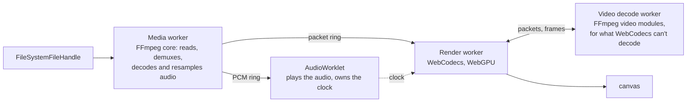

<picture>
  <source media="(prefers-color-scheme: dark)" srcset="https://raw.githubusercontent.com/singh-pk/snowy-media/main/brand/mark-dark.svg">
  
</picture>

# @snowy-media/engine

[](https://github.com/singh-pk/snowy-media/actions/workflows/ci.yml)
[](https://github.com/singh-pk/snowy-media/blob/main/LICENSES/LicenseRef-Snowy-License-1.0.txt)

The playback pipeline of [Snowy](https://github.com/singh-pk/snowy-media): it reads a local file, demuxes and decodes it with [`@snowy-media/ffmpeg`](../ffmpeg) and WebCodecs, keeps audio and video in sync, and draws into a canvas with WebGPU, all in workers. It has no user interface; the Snowy player and editor build on it.

> [!NOTE]
> In development: `bun add @snowy-media/engine`. Until 1.0 a minor version may change the API. It plays a file's first video and audio track (a file without audio does not play yet), and seeks and scrubs frame-exactly; see the [changelog](CHANGELOG.md) for what is there so far.

## How it works



Each worker is its own file, and the rings are `SharedArrayBuffer`s, so no packet or sample goes through `postMessage`. [docs/architecture.md](docs/architecture.md) is the design.

## Requirements

A page served with cross-origin isolation (`Cross-Origin-Opener-Policy: same-origin` and `Cross-Origin-Embedder-Policy: require-corp`) in desktop Chromium (Chrome, Edge), which has all it needs: WebAssembly SIMD and threads, AudioWorklet, WebGPU on an `OffscreenCanvas` in a worker, and WebCodecs. There is no fallback: where something is missing, `createEngine` says what.

The engine starts its workers and its AudioWorklet from the URLs of its own files (`import.meta.url`), and they load `@snowy-media/ffmpeg` the same way, so a bundler must leave both packages' files side by side. With Vite, add `optimizeDeps: { exclude: ["@snowy-media/engine", "@snowy-media/ffmpeg"] }` and `worker: { format: "es" }`.

```ts
import { createEngine, UnsupportedPlatformError } from "@snowy-media/engine";

try {
  const engine = await createEngine({ canvas: document.querySelector("canvas")! });
  const [handle] = await showOpenFilePicker();
  const { format, duration, tracks } = await engine.open(handle);
} catch (e) {
  if (e instanceof UnsupportedPlatformError) console.log(`This browser lacks ${e.feature}`);
}
```

## Licence

The [Snowy License 1.0](https://github.com/singh-pk/snowy-media/blob/main/LICENSES/LicenseRef-Snowy-License-1.0.txt): free for individuals, companies of up to 3 people, non-profits, education, open-source projects and evaluation. Larger companies using it in production need a company licence ([LICENSE.md](https://github.com/singh-pk/snowy-media/blob/main/LICENSE.md)). `@snowy-media/ffmpeg`, which it loads at run time, is LGPL-2.1-or-later.
