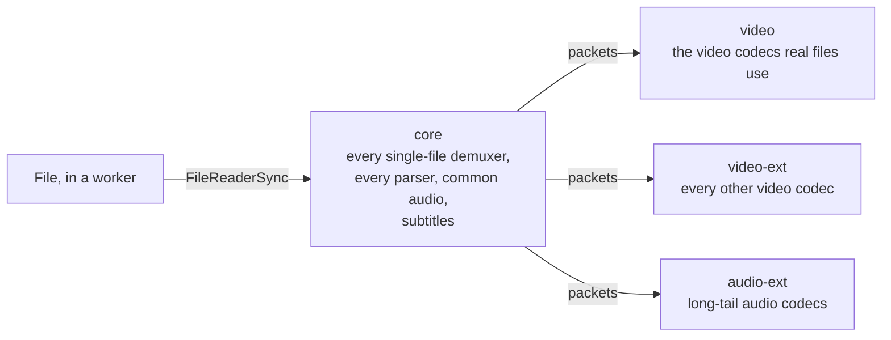

<picture>
  <source media="(prefers-color-scheme: dark)" srcset="https://raw.githubusercontent.com/singh-pk/snowy-media/main/brand/mark-dark.svg">
  
</picture>

# @snowy-media/ffmpeg

[](https://www.npmjs.com/package/@snowy-media/ffmpeg)
[](https://github.com/singh-pk/snowy-media/actions/workflows/ci.yml)
[](https://reuse.software)
[](https://github.com/singh-pk/snowy-media/blob/main/LICENSES/LGPL-2.1-or-later.txt)
[](https://ffmpeg.org)

FFmpeg 9 compiled to WebAssembly as small, lazily loaded modules for playing and editing video in the browser. It is the media engine of [Snowy](https://github.com/singh-pk/snowy-media).

- **Every format.** The `core` module opens every single-file container FFmpeg knows (350 demuxers) and decodes every common audio codec and every subtitle codec. Video is decoded by `video` (H.264, HEVC, VP9, AV1 through dav1d, ProRes, MPEG-2 and the other codecs real files use) and the remaining codecs by `video-ext` and `audio-ext`, each loaded only when a file needs it.
- **Fast.** It demuxes a 750 MB 1080p file in under a second in Chromium, where libav.js takes about 4 s ([benchmarks](bench/README.md)).
- **Exact.** Every fixture demuxes to the same streams, packets and timestamps as native `ffprobe`, and decodes to the same audio and the same video frames, byte for byte, as native `ffmpeg`.
- **Reproducible.** Pinned, checksummed and GPG-verified sources; CI checks that the output is byte-identical.

> [!NOTE]
> Pre-release: until 1.0 a minor version may change the API. The demuxing and decoding modules work; the muxing module is in development.

## What it is, and isn't

- **It is** FFmpeg's libraries (demuxing and decoding) as WebAssembly modules that JavaScript calls directly, reading files through a worker's `FileReaderSync` instead of a virtual filesystem.
- **It isn't** the `ffmpeg` command line in a browser. For that, use [ffmpeg.wasm](https://github.com/ffmpegwasm/ffmpeg.wasm).

## How it works



A page loads `core` first, and each other module only when a stream needs it.

## Install

```sh
npm install @snowy-media/ffmpeg
```

Each module is its own entry point: `@snowy-media/ffmpeg/core`, `/audio-ext`, `/video` and `/video-ext`, typed by its `index.d.ts`. A module loads its `.wasm` and starts its threads from the URL of its own `.js` file (`import.meta.url`), so serve the two side by side, unchanged. With Vite, add `optimizeDeps: { exclude: ["@snowy-media/ffmpeg"] }`: its development server otherwise moves the `.js` away from its `.wasm`. Every release is published from CI with [npm provenance](https://docs.npmjs.com/generating-provenance-statements), from a build byte-identical to `dist.sha256`, and its GitHub release attaches the complete source ([NOTICE](NOTICE)).

## Requirements

A [cross-origin isolated](https://developer.mozilla.org/docs/Web/API/Window/crossOriginIsolated) page (COOP + COEP headers) in current stable desktop Chromium (Chrome, Edge), which has WebAssembly SIMD and threads. Modules run in a dedicated worker.

## Usage

```js
// In a module worker on a cross-origin isolated page.
import { AVERROR_EOF, AVSEEK_SIZE, createCore } from "@snowy-media/ffmpeg/core";

const ready = createCore(); // start loading now; awaited per message so none is lost
const reader = new FileReaderSync();
let file;
let pos = 0;

const core = await ready;

// FFmpeg reads through these two hooks.
core.snyRead = (_io, buf, size) => {
  const bytes = new Uint8Array(reader.readAsArrayBuffer(file.slice(pos, pos + size)));
  core.HEAPU8.set(bytes, buf);
  pos += bytes.length;
  return bytes.length; // 0 means end of file
};
core.snySeek = (_io, offset, whence) => {
  if (whence === AVSEEK_SIZE) return BigInt(file.size);
  pos = [0, pos, file.size][whence] + Number(offset);
  return BigInt(pos);
};

self.onmessage = ({ data: input }) => {
  file = input; // a File from <input type=file> or drag and drop
  pos = 0;
  const out = core._malloc(4);
  const name = core.stringToNewUTF8(file.name); // the extension identifies some raw formats
  const err = core._sny_open(1, 4 << 20, name, out); // 4 MiB read buffer
  const ctx = core.HEAP32[out >> 2];
  core._free(name);
  core._free(out);
  if (err < 0) throw new Error(core.UTF8ToString(core._sny_strerror(err)));
  core._sny_find_stream_info(ctx);

  const pkt = core._sny_packet_alloc();
  let ret;
  while ((ret = core._sny_read(ctx, pkt)) >= 0) {
    const start = core._sny_packet_data(pkt);
    const bytes = core.HEAPU8.subarray(start, start + core._sny_packet_size(pkt));
    // Hand `bytes` for stream core._sny_packet_stream(pkt) to WebCodecs or a decoder.
  }
  if (ret !== AVERROR_EOF) console.error(core.UTF8ToString(core._sny_strerror(ret)));
  core._sny_packet_free(pkt);
  core._sny_close(ctx);
};
```

[docs/decoding.md](docs/decoding.md) decodes those packets: audio to 32-bit float planar, as Web Audio plays it, and video to WebCodecs `VideoFrame`s.

Every `_sny_*` call that can fail returns a negative AVERROR code, and `_sny_strerror` describes it. The full API is in [`src/`](src): [`demux.c`](src/demux.c), [`decode.c`](src/decode.c), [`audio.c`](src/audio.c), [`video.c`](src/video.c) and [`common.c`](src/common.c); `dist/core/index.d.ts` types every function and constant. [docs/architecture.md](docs/architecture.md) explains the design.

## Modules

| Module | Contents | Status |
| --- | --- | --- |
| `core` | every single-file demuxer, every parser, every common audio decoder, every subtitle decoder | available |
| `audio-ext` | the long-tail audio decoders (speech, game, legacy and niche lossless codecs) | available |
| `video` | the video decoders real files use (H.264, HEVC, VP8, VP9, AV1 through dav1d, MPEG-1/2/4, VC-1, ProRes, DNxHD, MJPEG, …), libswscale | available |
| `video-ext` | every other FFmpeg video decoder (images, screen capture, game and legacy codecs), libswscale | available |
| `mux` | muxers and audio encoders | in development |

## Building

Requires Docker with buildx, and [Bun](https://bun.sh).

```sh
bun install
bun run build   # dist/<module>/ for each module: module .js, .wasm, index.js, index.d.ts
bun test        # Chromium (run `bunx playwright install chromium` once)
```

## Contributing

Issues and pull requests are welcome, from people and from AI agents. Read [CONTRIBUTING.md](https://github.com/singh-pk/snowy-media/blob/main/CONTRIBUTING.md) first; agents start at [AGENTS.md](AGENTS.md). To report a vulnerability, see [SECURITY.md](https://github.com/singh-pk/snowy-media/blob/main/SECURITY.md).

## Acknowledgements

It grew out of [ffmpeg.wasm](https://github.com/ffmpegwasm/ffmpeg.wasm) by Jerome Wu and contributors, whose Docker-based Emscripten build showed the way. [libav.js](https://github.com/Yahweasel/libav.js) and [web-demuxer](https://github.com/bilibili/web-demuxer) are prior art for module variants and demux-only builds. And of course [FFmpeg](https://ffmpeg.org) itself.

## License

[LGPL-2.1-or-later](https://github.com/singh-pk/snowy-media/blob/main/LICENSES/LGPL-2.1-or-later.txt), like FFmpeg. [NOTICE](NOTICE) lists the bundled third-party code and its licences.
