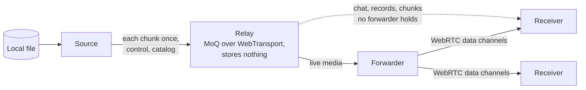

<picture>
  <source media="(prefers-color-scheme: dark)" srcset="https://raw.githubusercontent.com/singh-pk/snowy-media/main/brand/mark-dark.svg">
  
</picture>

# @snowy-media/sync

Live sessions for [Snowy](https://github.com/singh-pk/snowy-media), over a stateless [MoQ](https://datatracker.ietf.org/wg/moq/about/) relay on WebTransport. It runs two kinds:

- **Watch sessions:** one person plays a local file to a group of viewers, everyone shares a chat, and each viewer picks their own audio and subtitle tracks. Media goes once from the source to the relay and is shared onwards through WebRTC peer groups. It plays through [`@snowy-media/engine`](../engine).
- **Edit sessions:** people and agents edit one [`@snowy-media/timeline`](../timeline) project together. Each editor's media stays on their own disk and is streamed from there to the others who need it.

Every peer keeps its own copy of what it receives, so playback, chat and editing carry on through a dropped connection. Everything is end-to-end encrypted: the relay sees only track names and sizes.

> [!NOTE]
> In development and not yet published, with no public API yet. So far it has the signed and encrypted objects that sessions exchange (media chunks, the catalog, codec setups, control records and chat batches), the source's newest records as each peer holds them and as a joiner asks for them, and chat: ordering, edits, deletes and reactions, sending, and repairing missed messages from other peers. [docs/architecture.md](docs/architecture.md) is the design.

## How it works

A watch session, as designed; the forwarders and direct connections are not built yet.

A peer that turns on "Share my upload" and has the upload to spare forwards to a group, and every peer keeps what it received. [docs/architecture.md](docs/architecture.md) is the design, edit sessions included.

## Requirements

A page served with cross-origin isolation (`Cross-Origin-Opener-Policy: same-origin` and `Cross-Origin-Embedder-Policy: require-corp`) in desktop Chromium, as `@snowy-media/engine` needs, which also has WebTransport, WebRTC data channels, the Origin Private File System, IndexedDB, Ed25519 in Web Crypto, and the File System Access API: a source reads its media from a `FileSystemFileHandle` the app keeps, so it can serve the same file again after a reload. A session needs a MoQ relay, and a watch session two STUN endpoints for its peer groups; nothing else runs on a server.

## Licence

The [Snowy License 1.0](https://github.com/singh-pk/snowy-media/blob/main/LICENSES/LicenseRef-Snowy-License-1.0.txt): free for individuals, companies of up to 3 people, non-profits, education, open-source projects and evaluation. Larger companies using it in production need a company licence ([LICENSE.md](https://github.com/singh-pk/snowy-media/blob/main/LICENSE.md)).
