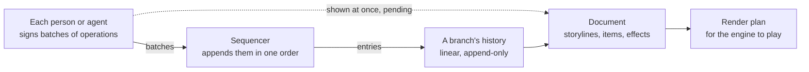

<picture>
  <source media="(prefers-color-scheme: dark)" srcset="https://raw.githubusercontent.com/singh-pk/snowy-media/main/brand/mark-dark.svg">
  
</picture>

# @snowy-media/timeline

The edit document of the [Snowy](https://github.com/singh-pk/snowy-media) editor: a magnetic timeline whose storyline closes up by itself and whose connected clips move with what they belong to, the typed operations that change it, and one linear history that every person and agent editing a project shares, with undo, revert and branches. It has no DOM, network or media, so it runs in Bun as well as the browser; [`@snowy-media/engine`](../engine) plays what it describes and [`@snowy-media/sync`](../sync) carries it between peers.

> [!NOTE]
> In development and not yet published, with no public API yet. So far it has time in flicks, item ids, storyline position keys, layout (the storyline's start times, connected items' times and lanes), batches of operations in signed canonical bytes, applying operations to a document (sequences, roles, assets, items, splits, joins, effects and keyframes), and a branch's history: signed entries, pending batches shown at once and settled by the sequencer, and concurrent entries marked; undo, redo, revert and going back to any entry; branches, created, merged and closed by entries; the logs and histories of the project folder, written in segments and opened again; and the render plan of a sequence's clips and transitions. [docs/architecture.md](docs/architecture.md) is the design.

## How it works

Every peer applies the same entries in the same order and reaches the same document; undo and revert are new batches.

## Licence

The [Snowy License 1.0](https://github.com/singh-pk/snowy-media/blob/main/LICENSES/LicenseRef-Snowy-License-1.0.txt). [LICENSE.md](https://github.com/singh-pk/snowy-media/blob/main/LICENSE.md) says who may use it free and when a company licence is needed.
